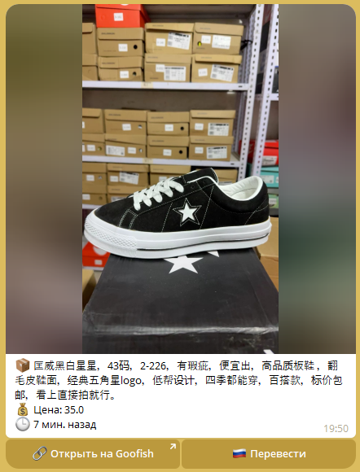
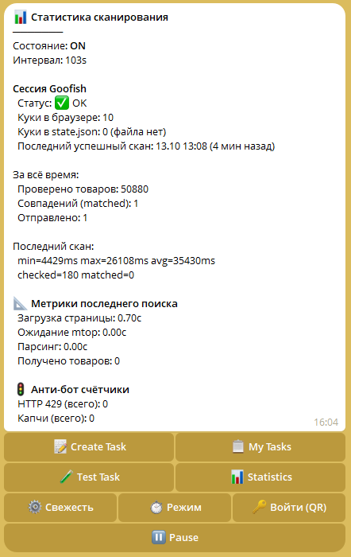

<div align="center">


# 👁️ GooEye

[](https://python.org)
[](https://playwright.dev)
[](https://core.telegram.org/bots/api)
[](LICENSE)
[]()

</div>

> ⚡ **Advanced real-time Goofish.com (闲鱼) sniper bot.** Multi-user isolation, human-like behavior evasion, and bilingual notifications engineered for high-frequency arbitrage.

GooEye is a highly asynchronous monitoring system that tracks new listings on the Chinese P2P platform Goofish in real-time. It features **complete user isolation**, advanced anti-bot evasion (humanizer), and seamless session management directly via Telegram. 

Designed for **resellers, collectors, and arbitrage traders** who require sub-minute reaction times without triggering platform anti-fraud systems.

---

## 📊 Engineering Metrics & Business Value

Live metrics from a 2+ day continuous production deployment demonstrate the efficacy of the architectural choices:

| Metric | Value | Business / Engineering Impact |
|--------|-------|-------------------------------|
| **Items Scanned** | 44,919 | High-throughput monitoring capability. |
| **CAPTCHAs Triggered** | **0** | Zero account ban risk. Humanizer successfully bypasses `baxia`/`fireyejs`. |
| **HTTP 429 Errors** | **0** | Perfect rate-limit adherence. No wasted requests or temporary IP bans. |
| **Notification Delivery** | **100%** (26/26) | Maximum capture rate for arbitrage opportunities. Zero false positives. |
| **Avg Scan Duration** | 29.1s | **Intentional latency.** 93% of this time is humanizer delay, trading raw speed for session longevity. |
| **Raw DOM Parsing** | 0.03s | Highly optimized extraction logic once the page is loaded. |

---

## 🏗️ Architecture & Design Decisions

```text
[ Telegram Users ] <──(Polling/Commands)──> [ Telegram Bot Core (PTB v21+) ]
                                                    │
                                                    ▼
                                           [ Monitor Orchestrator ]
                                                    │
          ┌─────────────────────────────────────────┼─────────────────────────────────────────┐
          ▼                                         ▼                                         ▼
[Deduplication DB]                     [ Smart Filters ]                         [ Translator (ZH→RU) ]
 (SQLite, auto-cleanup)              (Price, Keywords, Freshness)                   (On-demand)
                                                    │
                                                    ▼
                                     [ Multi-User Stealth Scraper Engine ]
                                     (Dict of Playwright instances per user_id)
                                     (Humanizer: random delays, scroll, shuffle)
                                                    │
                                                    ▼
                                     [ Goofish (闲鱼) Platform API/DOM ]
```

### ⚠️ Architectural Constraints & Mitigations
As a system handling persistent browser contexts and concurrent I/O, the following constraints are actively managed:
1. **Memory Management:** Headless Chromium instances are prone to gradual memory leaks. *Mitigation:* The architecture explicitly avoids Docker overhead in favor of native `systemd` with a configured `Restart=always` and a 12-hour lifecycle to gracefully flush V8 heap memory.
2. **Rate-Limiting (429):** Aggressive polling triggers immediate IP/session bans on Goofish. *Mitigation:* The `Humanizer` enforces a mandatory ~27s delay per cycle (mimicking human reading/scrolling time), reducing request frequency to a safe ~152s interval per task.
3. **Race Conditions:** Concurrent task updates from multiple users can corrupt shared state. *Mitigation:* All writes to `tasks.json` and the SQLite deduplication database are guarded by `asyncio.Lock` primitives to ensure serializable isolation.

---

## 🧠 Core Engineering Snippets

### Multi-Tenant Isolation & Concurrency
```python
class BrowserManager:
    def __init__(self):
        self._contexts: dict[int, BrowserContext] = {}
        # Mitigation: asyncio.Lock prevents race conditions when multiple 
        # Telegram users trigger task creation simultaneously.
        self._lock = asyncio.Lock() 

    async def get_context(self, user_id: int) -> BrowserContext:
        # ... existing code ...
        async with self._lock:
            if user_id not in self._contexts:
                # Strict isolation: prevents cross-contamination of cookies/sessions
                storage_path = f"state_{user_id}.json"
                context = await self._browser.new_context(storage_state=storage_path)
                self._contexts[user_id] = context
        return self._contexts[user_id]
        
    async def graceful_shutdown(self):
        # Mitigation: Explicitly flush V8 heap memory to prevent 
        # gradual Chromium memory leaks before systemd restarts the process.
        for ctx in self._contexts.values():
            await ctx.close()
        # ... existing code ...
```

### Advanced Humanizer (Anti-Bot Evasion)
```python
async def humanize_session(page: Page, mode: TimingMode):
    # Mitigation: Adaptive backoff prevents HTTP 429 (Too Many Requests) 
    # and CAPTCHA triggers by mimicking organic user variance.
    
    # 1. Simulate non-linear reading behavior (scrolling)
    for _ in range(random.randint(2, 5)):
        await page.mouse.wheel(0, random.uniform(300, 800))
        await asyncio.sleep(random.uniform(1.5, 3.2))
        
    # 2. Randomized mouse jitter to defeat canvas fingerprinting heuristics
    # ... existing code ...
    
    # 3. Task shuffling to avoid predictable sequential polling patterns
    # ... existing code ...
```

---

## 📱 Visuals & Observability

📸 Notifications 1: 

Rich Media Notifications: High-quality photos and inline action buttons for instant decision-making.

📸 Notifications 2: 

Rich Media Notifications: Bilingual side-by-side translations and inline action buttons for instant decision-making.

📸 Real-time Telemetry 2: 

Real-time Telemetry: Built-in Telegram interface provides live transparency into scan intervals, anti-bot counters (429/CAPTCHA), and infrastructure health.


---

## ✨ Feature Matrix

| Feature | Implementation Details |
|---------|------------------------|
| **Dual Search Modes** | Monitor by **Keywords** or by **Photo** (visual search via image upload). |
| **Smart Filters** | Price ranges, strict keyword inclusion/exclusion (title-only to avoid spam). |
| **Telegram QR-Login** | Headless QR-code generation and automatic cookie extraction. No SSH required. |
| **Security** | Custom `SecretFilter` automatically masks `BOT_TOKEN` and PII in stdout/stderr. |

---

## 🚀 Quick Start

```bash
# 1. Clone and setup environment
git clone https://github.com/sleepti3ht/gooeye.git
cd gooeye
python3 -m venv .venv
source .venv/bin/activate  # On Windows: .venv\Scripts\activate

# 2. Install dependencies and browser binaries
pip install -r requirements.txt
python -m playwright install chromium --with-deps

# 3. Configure
cp .env.example .env
# Edit .env with your BOT_TOKEN, ALLOWED_USER_IDS, and preferred TIMING_MODE

# 4. Run locally
python main.py
```

> **Production Deployment:** The repository includes a ready-to-use `gooeye.service` file for `systemd`, ensuring auto-start on boot and automatic restarts on failure.

---

## 📁 Project Structure

```text
gooeye/
├── main.py                  # Entry point, asyncio lifecycle management
├── monitor.py               # Main orchestrator (manages dict of user scrapers)
├── tasks.py                 # Centralized task management (tasks.json with user_id)
├── config.py                # Settings validation and loading from .env
│
├── bot/                     
│   ├── handlers.py          # Telegram commands, conversations, and menus
│   ├── notifications.py     # Rich media card formatting and retry logic
│   └── qr_login.py          # Headless QR-code generation and cookie extraction
│
├── scraper/                 
│   ├── browser.py           # Multi-user BrowserManager (isolated profiles)
│   ├── goofish_scraper.py   # DOM parsing, mtop API interception, humanizer
│   └── anti_bot.py          # Stealth scripts and evasion helpers
│
├── filters/                 # Logic for price and strict keyword filtering
├── translator/              # Module for ZH → RU title/description translation
├── database/                # SQLite deduplication and old record cleanup
├── images/                  # Stored user-uploaded images for photo-search tasks
└── utils/                   # Custom logging with SecretFilter (token masking)
```

---

## 🔧 Troubleshooting

| Symptom | Root Cause | Mitigation |
|---------|------------|------------|
| **Browser crashes after 24h** | V8/Chromium memory leak over time. | Rely on `systemd` auto-restart (`Restart=always`, max 12h uptime). |
| **CAPTCHA appears** | Timing mode too aggressive for current IP reputation. | Switch to `HUMAN` or `IRONCLAD` mode in `.env`. |
| **QR code expires** | Network latency between VPS and Alibaba auth servers. | Re-run `/login` command. Ensure VPS has stable routing to China. |

---

## 📈 Development Phases

- [x] **Phase 1: MVP** — Basic Playwright scraper, HTML parsing, SQLite deduplication.
- [x] **Phase 2: Core Features** — Translation layer, rich media cards, user allowlist, freshness filters.
- [x] **Phase 3: Production Ready** — `systemd` deployment, persistent cookie profiles, advanced Humanizer (4 modes).
- [x] **Phase 4: Multi-User & UX** — Isolated profiles per `user_id`, Telegram QR-Code login, Photo-based search tasks.
- [ ] **Phase 5: Scale & Resilience** — Residential proxy rotation fallback, price-drop tracking, advanced analytics dashboard.

---

## 🔐 Security Philosophy

- **Pragmatic Solo-Dev Design:** Explicitly avoids Docker overhead. Native `venv` + `systemd` provides maximum performance and minimal RAM/Disk usage on small VPS instances (e.g., 4GB RAM can comfortably handle 10+ isolated user browsers).
- **Respectful Scraping:** Built-in adaptive delays, task shuffling, and scroll simulation to avoid triggering anti-fraud systems.
- **Zero Secrets in Repo:** All sensitive data is strictly managed via `.env` and masked in console logs via custom `SecretFilter`.
